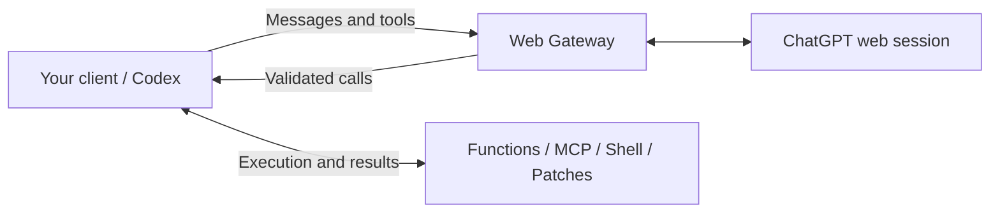

<h1 align="center">ChatGPT Web Gateway</h1>

<p align="center">Connect your ChatGPT session to standard API clients, tools, and Codex.</p>

<p align="center">
  <a href="https://github.com/pythc/chatgpt-web-gateway/actions/workflows/test.yml"></a>
  <a href="LICENSE"></a>
  
</p>

<p align="center"><strong>English</strong> · <a href="README.zh-CN.md">简体中文</a></p>

<p align="center"></p>

<p align="center">
  <a href="#quickstart">Quickstart</a> ·
  <a href="#use-the-openai-sdk">SDK</a> ·
  <a href="#tools-and-mcp">Tools &amp; MCP</a> ·
  <a href="#codex-cli">Codex</a> ·
  <a href="#documentation">Documentation</a>
</p>

A self-hosted gateway exposing **OpenAI-compatible Chat Completions and Responses APIs** over your ChatGPT web session. Keep your existing client tool loop and use file-based configuration to deploy locally.

| Standard clients | Client-owned tools | Local deployment |
| --- | --- | --- |
| OpenAI SDK, Responses, Codex CLI | Function calling, MCP, Shell and patches | Docker Compose, `.env`, credential files |

## Quickstart

Requires Docker with Compose. The default service binds to `127.0.0.1`.

### 1. Prepare the files

```sh
git clone https://github.com/pythc/chatgpt-web-gateway.git
cd chatgpt-web-gateway
cp .env.example .env
mkdir -p data
touch data/token.txt
chmod 700 data
chmod 600 .env data/token.txt
```

### 2. Configure your account

- In `.env`, set `API_PREFIX` to a path such as `gateway`, and replace `AUTHORIZATION` with your own random client API key.
- In `data/token.txt`, save your ChatGPT access token or complete session JSON containing `accessToken`. Multiple accounts can use one token per line or a JSON array of token strings.
- Adjust the model and `PROXY_URL` if needed. The sample requests `gpt-6-thinking` with High effort; use an exact model ID available to your account.

The **client API key** and **ChatGPT login token** are different credentials. Keep the login token on the gateway. Private configuration and runtime data are excluded from Git and image builds.

### 3. Start the gateway

```sh
docker compose up -d --build
```

| Client setting | Value |
| --- | --- |
| Base URL | `http://127.0.0.1:5005/<API_PREFIX>/v1` |
| API key | `AUTHORIZATION` from `.env` |
| Model | An ID returned by `GET /v1/models` |

For credential updates, native-only deployment, read-only secret mounts, proxies and rollback, see [Configuration](docs/configuration.md).

## Use the OpenAI SDK

Install the example dependencies and set your client environment:

```sh
pip install -r requirements.examples.txt
export OPENAI_BASE_URL='http://127.0.0.1:5005/<API_PREFIX>/v1'
export OPENAI_API_KEY='<client key from .env>'
export CHATGPT_MODEL='<available model ID>'
```

```python
import os
from openai import OpenAI

client = OpenAI(max_retries=0, timeout=620)
reply = client.chat.completions.create(
    model=os.environ["CHATGPT_MODEL"],
    messages=[{"role": "user", "content": "Hello!"}],
    max_tokens=512,
)
print(reply.choices[0].message.content)
```

SDK retries are disabled so an unknown generation outcome is not silently replayed. See [the runnable example](examples/chat.py).

## Tools and MCP

Declare tools, receive validated calls, execute them in your client, and return their results. MCP servers connect to your client, which supplies their tool schemas and execution results to the gateway.



```sh
python examples/tools.py       # Function-call round trip
python examples/mcp_client.py  # Client-side MCP round trip
```

Tools run under the client's permissions and approvals. The gateway does not execute client Shell commands, apply patches, or manage MCP OAuth credentials.

## Codex CLI

With the client environment above and Codex installed:

```sh
python scripts/codex_run.py --ephemeral \
  --cwd /absolute/path/to/project --sandbox workspace-write \
  'Inspect the failing tests, fix the bug, and verify the result.'
```

Use Responses with function, custom text/grammar and namespace tools, client-side stdio or Streamable HTTP MCP, app-server conversations, and optional WebSocket transport. See [Codex setup](docs/codex-compatibility.md), [provider configuration](examples/codex_gateway.toml), and [tested compatibility](docs/validation.md).

Web and native Responses backends are explicitly configured as separate routes; a request never silently switches models or backends.

## Compatibility at a glance

| Capability | Scope |
| --- | --- |
| Chat Completions | Text, history, function calling and text-only JSON object mode |
| Responses / Codex | Typed SSE, function/custom/namespace tools, bounded context replay and compaction |
| Client-side MCP | stdio and Streamable HTTP, executed by your client |
| WebSocket | Opt-in; one response at a time per socket; generation-free warmup |
| Model discovery | Account-specific IDs and reasoning levels; unknown models fail explicitly |
| Web tool streaming | Complete tool frames are buffered and validated before calls are emitted |

The web backend uses a validated text bridge. Model behavior, latency and quotas depend on the upstream service and your account. Hosted API tools and full official API parity are outside its scope. See the [backend differences and limits](docs/codex-compatibility.md).

## Documentation

| Guide | Contents |
| --- | --- |
| [Configuration](docs/configuration.md) | Credentials, environment variables, proxies, upgrades and rollback |
| [Codex integration](docs/codex-compatibility.md) | Providers, MCP, app-server, state and transport |
| [Compatibility and validation](docs/validation.md) | Tested versions, supported flows and reproducible checks |
| [Architecture](docs/architecture.md) | Request flow, tool execution and response state |

## Development

Run the offline suites without account access or model usage:

```sh
docker build -t chatgpt-web-gateway:test .
docker run --rm --network none --entrypoint python \
  chatgpt-web-gateway:test scripts/test.py
```

See [validation](docs/validation.md) for local Python and opt-in live checks. Runtime configuration, account files, logs and local work notes belong outside version control.

## Community

Questions and ideas: [Discussions](https://github.com/pythc/chatgpt-web-gateway/discussions).
Reproducible bugs and client results: [Issue forms](https://github.com/pythc/chatgpt-web-gateway/issues/new/choose).
English and Chinese are welcome.

[Contributing](CONTRIBUTING.md) · [Support](SUPPORT.md) ·
[Code of Conduct](CODE_OF_CONDUCT.md) · [Security](SECURITY.md) ·
[Client compatibility](docs/compatibility.md) · [Changelog](CHANGELOG.md) ·
[Releases and rollback](docs/releasing.md) · [Demo walkthrough](docs/demo.md)

The public roadmap lives in [Milestones](https://github.com/pythc/chatgpt-web-gateway/milestones).
0.x versions are previews; compatibility is versioned and backend-specific.

## License

[MIT](LICENSE) · Derived from [lanqian528/chat2api](https://github.com/lanqian528/chat2api), with attribution in [NOTICE](NOTICE). An independent community project, unaffiliated with OpenAI.
