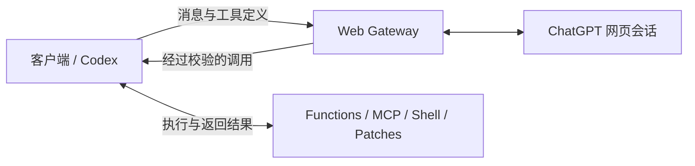

<h1 align="center">ChatGPT Web Gateway</h1>

<p align="center">将你的 ChatGPT 会话接入标准 API 客户端、工具和 Codex。</p>

<p align="center">
  <a href="https://github.com/pythc/chatgpt-web-gateway/actions/workflows/test.yml"></a>
  <a href="LICENSE"></a>
  
</p>

<p align="center"><a href="README.md">English</a> · <strong>简体中文</strong></p>

<p align="center"></p>

<p align="center">
  <a href="#快速开始">快速开始</a> ·
  <a href="#使用-openai-sdk">SDK</a> ·
  <a href="#工具与-mcp">工具与 MCP</a> ·
  <a href="#codex-cli">Codex</a> ·
  <a href="#文档导航">文档</a>
</p>

一个可自行部署的网关，将 ChatGPT 网页会话转换为 **OpenAI 兼容的 Chat Completions 和 Responses API**。沿用客户端的工具调用流程，通过配置文件在本地部署。

| 标准客户端 | 客户端执行工具 | 本地部署 |
| --- | --- | --- |
| OpenAI SDK、Responses、Codex CLI | Function Calling、MCP、Shell 和补丁 | Docker Compose、`.env`、凭证文件 |

## 快速开始

需要 Docker Compose。默认服务仅监听 `127.0.0.1`。

### 1. 准备文件

```sh
git clone https://github.com/pythc/chatgpt-web-gateway.git
cd chatgpt-web-gateway
cp .env.example .env
mkdir -p data
touch data/token.txt
chmod 700 data
chmod 600 .env data/token.txt
```

### 2. 配置账号

- 编辑 `.env`：将 `API_PREFIX` 设为自己的路径前缀，例如 `gateway`；将 `AUTHORIZATION` 替换为自己的随机客户端 API Key。
- 编辑 `data/token.txt`：保存 ChatGPT access token，或包含 `accessToken` 的完整会话 JSON。多账号可使用每行一个 token，或 token 字符串的 JSON 数组。
- 按需调整模型与 `PROXY_URL`。示例请求 `gpt-6-thinking` + High；请使用账号实际可用的准确模型 ID。

**客户端 API Key** 和 **ChatGPT 登录 token** 是两套凭证。登录 token 保留在网关端。私有配置与运行数据不进入 Git 或镜像。

### 3. 启动网关

```sh
docker compose up -d --build
```

| 客户端配置 | 值 |
| --- | --- |
| Base URL | `http://127.0.0.1:5005/<API_PREFIX>/v1` |
| API Key | `.env` 中的 `AUTHORIZATION` |
| Model | `GET /v1/models` 返回的模型 ID |

凭证更新、仅使用原生后端、只读密钥挂载、代理与回滚方式见[配置说明](docs/configuration.md)。

## 使用 OpenAI SDK

安装示例依赖并设置客户端环境：

```sh
pip install -r requirements.examples.txt
export OPENAI_BASE_URL='http://127.0.0.1:5005/<API_PREFIX>/v1'
export OPENAI_API_KEY='<.env 中的客户端密钥>'
export CHATGPT_MODEL='<实际可用的模型 ID>'
```

```python
import os
from openai import OpenAI

client = OpenAI(max_retries=0, timeout=620)
reply = client.chat.completions.create(
    model=os.environ["CHATGPT_MODEL"],
    messages=[{"role": "user", "content": "你好！"}],
    max_tokens=512,
)
print(reply.choices[0].message.content)
```

示例关闭 SDK 自动重试，避免结果未知的生成请求被静默重发。可直接运行[完整示例](examples/chat.py)。

## 工具与 MCP

声明工具、接收经过校验的调用、在客户端执行，再返回结果。MCP 服务器由客户端连接，客户端将工具定义和实际执行结果交给网关。



```sh
python examples/tools.py       # 函数工具完整调用流程
python examples/mcp_client.py  # 客户端 MCP 完整调用流程
```

工具遵守客户端的权限和审批。网关不在服务端执行客户端 Shell、应用补丁或管理 MCP OAuth 凭证。

## Codex CLI

配置好上述环境变量并安装 Codex 后：

```sh
python scripts/codex_run.py --ephemeral \
  --cwd /absolute/path/to/project --sandbox workspace-write \
  '检查失败测试，修复缺陷并验证结果。'
```

通过 Responses 使用 function、custom text/grammar、namespace 工具，客户端 stdio/Streamable HTTP MCP、app-server 会话及可选 WebSocket。参见 [Codex 配置](docs/codex-compatibility.zh-CN.md)、[provider 示例](examples/codex_gateway.toml)和[兼容性验证](docs/validation.md)。

网页与原生 Responses 后端是显式配置的独立路由，请求不会静默更换模型或后端。

## 兼容范围

| 能力 | 范围 |
| --- | --- |
| Chat Completions | 文本、历史消息、函数工具与纯文本 JSON object 模式 |
| Responses / Codex | 类型化 SSE、function/custom/namespace 工具、有界上下文重放及压缩 |
| 客户端 MCP | stdio 与 Streamable HTTP，由客户端执行 |
| WebSocket | 主动开启；每个连接同一时刻一条响应；预热零推理 |
| 模型目录 | 账号可用的准确 ID 和推理强度；未知模型明确失败 |
| 网页工具流 | 完整缓冲并校验工具封装后，再交付调用 |

网页后端采用经过校验的文本桥接。模型行为、延迟和额度取决于上游服务及账号。托管 API 工具与官方 API 全量等价不在支持范围内，详见[后端差异和限制](docs/codex-compatibility.zh-CN.md)。

## 文档导航

| 文档 | 内容 |
| --- | --- |
| [配置说明](docs/configuration.md) | 凭证、环境变量、代理、升级及回滚 |
| [Codex 接入](docs/codex-compatibility.zh-CN.md) | Provider、MCP、app-server、状态及传输 |
| [兼容性验证](docs/validation.md) | 已测试版本、能力范围和可复现的检查 |
| [架构](docs/architecture.md) | 请求流程、工具执行和响应状态 |

## 开发

离线套件不读取账号池，也不消耗模型用量：

```sh
docker build -t chatgpt-web-gateway:test .
docker run --rm --network none --entrypoint python \
  chatgpt-web-gateway:test scripts/test.py
```

本机 Python 测试和主动触发的真实模型验收见[验证说明](docs/validation.md)。运行配置、账号文件、日志和本地工作笔记不应进入版本控制。

## 社区

使用问题和想法请到 [Discussions](https://github.com/pythc/chatgpt-web-gateway/discussions)，
可复现缺陷和客户端实测结果请使用 [Issue 表单](https://github.com/pythc/chatgpt-web-gateway/issues/new/choose)。欢迎中英文反馈。

[贡献指南](CONTRIBUTING.md) · [支持说明](SUPPORT.md) ·
[行为准则](CODE_OF_CONDUCT.md) · [安全报告](SECURITY.md) ·
[客户端兼容矩阵](docs/compatibility.md) · [更新日志](CHANGELOG.md) ·
[版本发布与回滚](docs/releasing.md) · [演示步骤](docs/demo.md)

公开路线图见 [Milestones](https://github.com/pythc/chatgpt-web-gateway/milestones)。
0.x 为预览版，兼容性结论按客户端版本与后端分别记录。社区专项文档以英文为主。

## 许可证

[MIT](LICENSE) · 基于 [lanqian528/chat2api](https://github.com/lanqian528/chat2api) 开发，上游署名见 [NOTICE](NOTICE)。独立社区项目，与 OpenAI 无隶属关系。
