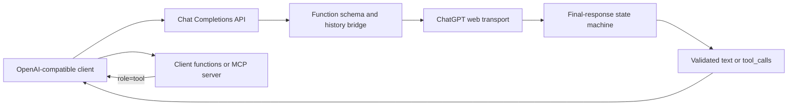
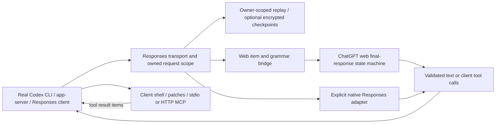

# Architecture / 架构

`api/client_tools.py` serializes declarations and historical tool data into a
nonce-bound text protocol. It validates returned names, argument schemas,
parallel-call constraints, and call/result associations. It never executes a
function. MCP server discovery and invocation belong to the client.

`chatgpt/webStream.py` tracks final-channel responses separately from other
message channels. `ChatService.py` handles transport and bounded read recovery.
`api/continuation.py` assembles explicit continuations and stops on unverified
boundaries. Recovery reads are distinct from generation requests.

`chatgpt/requestScope.py` owns an individual request's deadline and cancellation.
It records whether local work finished; local cancellation does not prove that
an upstream generation stopped. Diagnostic metadata avoids retaining prompts,
responses, credential-bearing URLs, or arbitrary error text in lifecycle logs.

工具声明、历史调用及结果经过文本协议桥接；只有客户端执行函数或 MCP 调用。
状态机区分最终正文与其他消息通道；传输恢复读取与新生成请求分别计数。
请求生命周期控制本地任务、超时及取消，但本地取消不等于远端生成已经停止。

## Responses and Codex

`responses_protocol.py` preserves call IDs, namespace identity and custom text.
`tool_grammar.py` validates grammar-constrained strings in a bounded subprocess;
it normalizes Codex's nullable patch-line terminal without executing tool input.
`responses_events.py` writes typed item/delta/terminal events. Tool-enabled web
turns are buffered through validation; tool-free final text can stream live.

`responses_state.py` separates bounded RAM replay from explicit local storage.
Native opaque state is forwarded unchanged. Web compaction is a gateway-owned
summary/checkpoint; it cannot reconstruct native encrypted reasoning. Neither
transport silently changes model/account or retries an uncertain generation.

Responses 只承担模型提供方职责，客户端保留执行、MCP、Skills 和审批。
原生与网页后端显式区分；网页工具信封及 custom grammar 完整校验后交付。
状态按客户端密钥隔离，`store=false` 不落盘；本地摘要不冒充原生推理状态。
